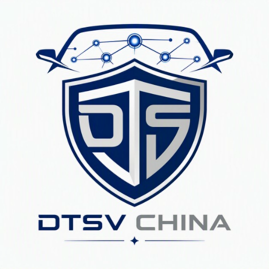

<p align="center">
  <a href="#">
    
  </a>
  <h1 align="center">OpenTPM</h1>
  <p align="center">AI-Powered Test Process Management & Defect Analysis Platform</p>
</p>

---

## Overview

**OpenTPM** is an AI-driven test process management platform built on top of [LibreChat](https://github.com/danny-avila/LibreChat). It integrates large language model capabilities with automotive testing workflows — enabling intelligent defect analysis, test case generation, and quality insights through natural language interaction.

## Key Features

### Defect Intelligence
- Conversational defect querying and analysis
- Automated defect-to-test-case mapping
- Severity classification and trend analysis
- Natural language reporting for quality metrics

### Test Case Management
- AI-assisted test case generation from defect descriptions
- Batch test case creation with pattern recognition
- Test coverage gap identification
- Traceability between requirements, defects, and test cases

### AI Agent & MCP Integration
- Custom MCP (Model Context Protocol) servers for domain-specific tools
- Agent-based workflows for complex analysis tasks
- Multi-model orchestration for different analysis stages
- Extensible plugin architecture for new testing tools

### Enterprise-Ready
- SSO authentication integration
- Multi-tenant deployment support
- Private/on-premise deployment with Docker
- Configurable model endpoints (local LLM, cloud API, or hybrid)

## Getting Started

### Prerequisites

- Node.js v24+
- MongoDB 7.0+
- npm (comes with Node.js)
- Python 3.10+ (required when BMW SSO is enabled)

### Installation

```bash
# Clone the repository
git clone https://github.com/tonyoorz/OpenTPM.git
cd OpenTPM

# Install dependencies
npm run smart-reinstall

# Copy and configure environment
cp .env.example .env
# Edit .env with your configuration

# When BMW_SSO_ENABLED=true, install the BMW SSO session keeper once
cd services/session-keeper
python -m venv .venv
.venv/bin/python -m pip install -e ".[session-keeper]"

# Start the BMW SSO session keeper (port 8090)
.venv/bin/python -m session_keeper

# In another terminal, return to the repository root
cd ../..

# Start the backend (port 3080)
npm run backend:dev

# In another terminal, start the frontend (port 3090)
npm run frontend:dev
```

When `BMW_SSO_ENABLED=true`, the backend requires the session keeper at
`SESSION_KEEPER_URL` (default: `http://localhost:8090`). Without it, BMW login
requests fail before the provided credentials are verified. Set
`BMW_SSO_ENABLED=false` if BMW SSO is not needed for local development.

On Windows PowerShell, replace `.venv/bin/python` with `.venv\Scripts\python.exe`.

### Windows Development

For a BMW SSO-enabled local installation, complete this one-time setup from
PowerShell:

```powershell
npm run smart-reinstall

Set-Location services\session-keeper
py -3 -m venv .venv
.\.venv\Scripts\python.exe -m pip install -e ".[session-keeper]"
Set-Location ..\..
```

MongoDB must be available at the `MONGO_URI` configured in `.env` before
starting the application. The default launcher starts MongoDB automatically
only when `mongod.exe` is at
`$env:USERPROFILE\Desktop\mongodb\mongodb-win32-x86_64-windows-7.0.20\bin\mongod.exe`.
For another installation path, configure the launcher in the same terminal:

```powershell
$env:MONGOD_PATH = 'C:\path\to\mongod.exe'
$env:MONGOD_DATA_PATH = 'C:\path\to\mongodb-data'
```

Start the complete local development stack with one command:

```powershell
npm run dev
```

The launcher reuses running services and starts any missing MongoDB,
session-keeper, backend, or frontend process. Backend changes reload through
nodemon, frontend changes reload through Vite, and session-keeper changes reload
when it is started by the launcher.

The local services are available at:

- Frontend and login: `http://localhost:3090/login`
- Backend health: `http://localhost:3080/health`
- BMW SSO session keeper: `http://localhost:8090/docs` (local machine only)

For LAN access, users should connect only to the backend or deployed frontend.
The session keeper must remain bound to `127.0.0.1`; it handles credentials and
cached SSO cookies for every user and is an internal backend dependency.

To run the services in separate terminals instead of using the launcher, start
MongoDB first, then run:

```powershell
# Terminal 1, only when BMW_SSO_ENABLED=true
.\services\session-keeper\.venv\Scripts\python.exe -m uvicorn session_keeper.app:app --host 127.0.0.1 --port 8090 --reload

# Terminal 2
npm run backend:dev

# Terminal 3
npm run frontend:dev
```

Do not run the separate frontend command while `npm run dev` is running; Vite
will select port 3091 because the launcher already uses port 3090.

### Applying Local Changes

With `npm run dev` running, frontend changes are applied by Vite hot reload,
while backend and session-keeper Python changes reload automatically. Restart
the local stack after changing `.env`, `start-all.bat`, dependencies, or other
startup configuration:

```powershell
# Stop the frontend, backend, and session keeper without stopping MongoDB data.
$ports = 3080, 3090, 8090
Get-NetTCPConnection -State Listen -ErrorAction SilentlyContinue |
  Where-Object { $_.LocalPort -in $ports } |
  Select-Object -ExpandProperty OwningProcess -Unique |
  ForEach-Object { Stop-Process -Id $_ -Force }

# Start the local stack again.
npm run dev
```

If MongoDB was also started for this development session and should be stopped,
run `Stop-Process -Name mongod` separately.

### Docker Deployment

```bash
cp .env.example .env
# Edit .env with your configuration

# BMW deployment: starts API, session keeper, MongoDB, and supporting services
docker compose -f deploy-compose.yml up --build -d
```

## Tech Stack

| Layer | Technology |
|---|---|
| Backend | Node.js, Express |
| Frontend | React, TypeScript, Tailwind CSS |
| Database | MongoDB |
| AI | Multi-model support (OpenAI-compatible APIs, local LLMs) |
| Tooling | Model Context Protocol (MCP) servers |

## Acknowledgements

This project is built on [LibreChat](https://github.com/danny-avila/LibreChat) by Danny Avila. We gratefully acknowledge the upstream project and its community.

## License

This project inherits the MIT License from the upstream LibreChat project. See [LICENSE](LICENSE) for details.

## Links

- **GitHub**: [github.com/tonyoorz/OpenTPM](https://github.com/tonyoorz/OpenTPM)
- **Upstream**: [github.com/danny-avila/LibreChat](https://github.com/danny-avila/LibreChat)
